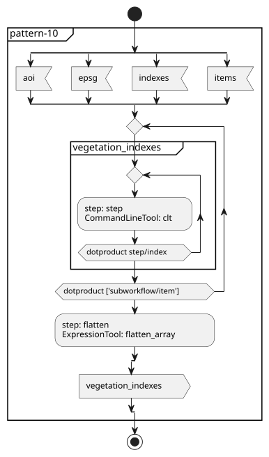
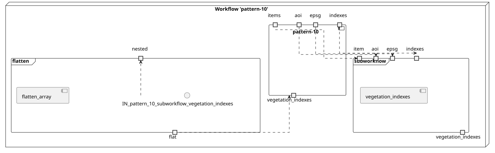
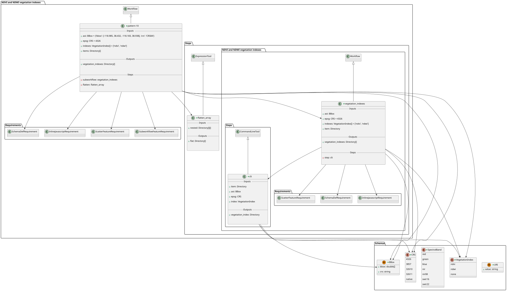
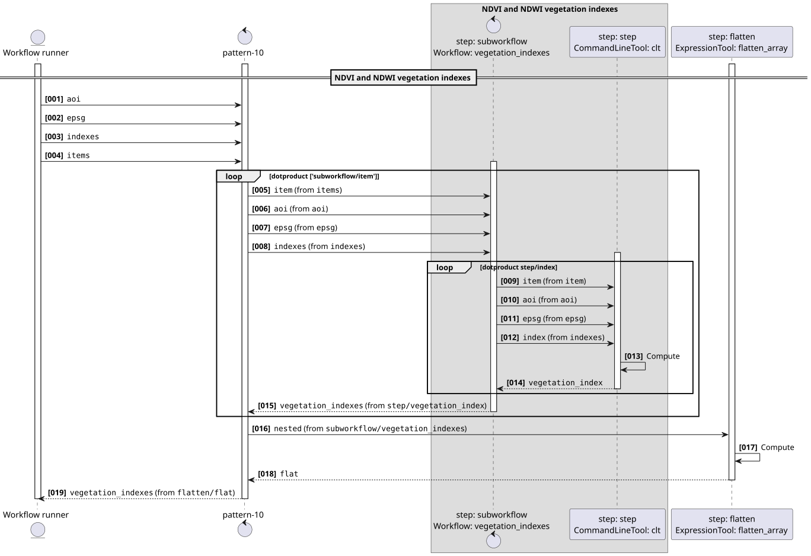
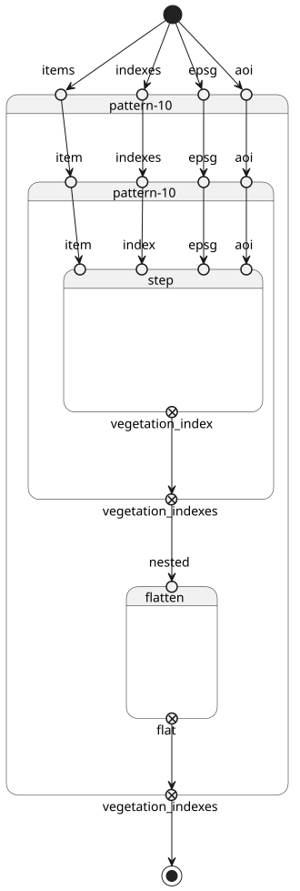
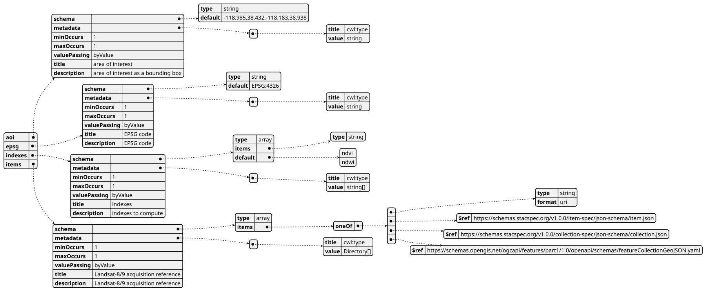
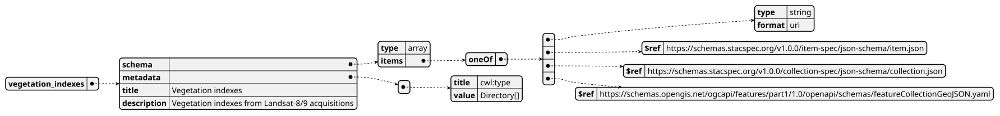

# pattern-10

Repository: https://github.com/eoap/application-package-patterns

Version: 2.0.0

License: {'@type': 's:CreativeWork', 's:identifier': 'Apache-2.0', 's:name': 'Apache License 2.0', 's:url': 'https://spdx.org/licenses/Apache-2.0.html'}

Author: Lois Lane (lois.lane@meoga.com)

Author: Clark Kent (clark.kent@meoga.com)

## NDVI and NDWI vegetation indexes

NDVI and NDWI vegetation indexes from Landsat-8/9 acquisitions

### Inputs

| Name | Type | Description |
| --- | --- | --- |
| aoi | `#BBox` | area of interest as a bounding box |
| epsg | `#CRS` | EPSG code |
| indexes | `#VegetationIndex[]` | indexes to compute |
| items | `Directory[]` | Landsat-8/9 acquisition reference |

### Outputs

| Name | Type | Description |
| --- | --- | --- |
| vegetation_indexes | `{'type': 'array', 'items': 'Directory'}` | Vegetation indexes from Landsat-8/9 acquisitions |

### Type `https://raw.githubusercontent.com/eoap/schemas/main/string_format.yaml#URI`

```yaml
name: https://raw.githubusercontent.com/eoap/schemas/main/string_format.yaml#URI
type: record
fields:
- name: value
  type: string
```

### Type `#BBox`

```yaml
name: '#BBox'
type: record
fields:
- name: bbox
  type:
    type: array
    items: double
- name: crs
  type: string
```

### Type `#SpectralBand`

```yaml
name: '#SpectralBand'
type: enum
symbols:
- red
- green
- blue
- nir
- nir08
- swir16
- swir22
```

### Type `#CRS`

```yaml
name: '#CRS'
type: enum
symbols:
- '4326'
- '3857'
- '32610'
- '32611'
- native
```

### Type `#VegetationIndex`

```yaml
name: '#VegetationIndex'
type: enum
symbols:
- ndvi
- ndwi
- none
```

## NDVI and NDWI vegetation indexes

NDVI and NDWI vegetation indexes

### Inputs

| Name | Type | Description |
| --- | --- | --- |
| aoi | `#BBox` | area of interest as a bounding box |
| epsg | `#CRS` | EPSG code |
| indexes | `#VegetationIndex[]` | indexes to compute |
| item | `Directory` | Reference to a STAC item |

### Outputs

| Name | Type | Description |
| --- | --- | --- |
| vegetation_indexes | `Directory[]` | Vegetation indexes |

### Type `https://raw.githubusercontent.com/eoap/schemas/main/string_format.yaml#URI`

```yaml
name: https://raw.githubusercontent.com/eoap/schemas/main/string_format.yaml#URI
type: record
fields:
- name: value
  type: string
```

### Type `#BBox`

```yaml
name: '#BBox'
type: record
fields:
- name: bbox
  type:
    type: array
    items: double
- name: crs
  type: string
```

### Type `#SpectralBand`

```yaml
name: '#SpectralBand'
type: enum
symbols:
- red
- green
- blue
- nir
- nir08
- swir16
- swir22
```

### Type `#CRS`

```yaml
name: '#CRS'
type: enum
symbols:
- '4326'
- '3857'
- '32610'
- '32611'
- native
```

### Type `#VegetationIndex`

```yaml
name: '#VegetationIndex'
type: enum
symbols:
- ndvi
- ndwi
- none
```

## clt

application-package-patterns: clt.

### Inputs

| Name | Type | Description |
| --- | --- | --- |
| item | `Directory` | item. |
| aoi | `#BBox` | aoi. |
| epsg | `#CRS` | epsg. |
| index | `#VegetationIndex` | index. |

### Outputs

| Name | Type | Description |
| --- | --- | --- |
| vegetation_index | `Directory` | vegetation index. |

### Type `https://raw.githubusercontent.com/eoap/schemas/main/string_format.yaml#URI`

```yaml
name: https://raw.githubusercontent.com/eoap/schemas/main/string_format.yaml#URI
type: record
fields:
- name: value
  type: string
```

### Type `#BBox`

```yaml
name: '#BBox'
type: record
fields:
- name: bbox
  type:
    type: array
    items: double
- name: crs
  type: string
```

### Type `#SpectralBand`

```yaml
name: '#SpectralBand'
type: enum
symbols:
- red
- green
- blue
- nir
- nir08
- swir16
- swir22
```

### Type `#CRS`

```yaml
name: '#CRS'
type: enum
symbols:
- '4326'
- '3857'
- '32610'
- '32611'
- native
```

### Type `#VegetationIndex`

```yaml
name: '#VegetationIndex'
type: enum
symbols:
- ndvi
- ndwi
- none
```

## Flatten Directory[][] → Directory[]

application-package-patterns: Flatten Directory[][] → Directory[].

### Inputs

| Name | Type | Description |
| --- | --- | --- |
| nested | `{'type': 'array', 'items': {'type': 'array', 'items': 'Directory'}}` | nested. |

### Outputs

| Name | Type | Description |
| --- | --- | --- |
| flat | `{'type': 'array', 'items': 'Directory'}` | flat. |

### Type `https://raw.githubusercontent.com/eoap/schemas/main/string_format.yaml#URI`

```yaml
name: https://raw.githubusercontent.com/eoap/schemas/main/string_format.yaml#URI
type: record
fields:
- name: value
  type: string
```

### Type `#BBox`

```yaml
name: '#BBox'
type: record
fields:
- name: bbox
  type:
    type: array
    items: double
- name: crs
  type: string
```

### Type `#SpectralBand`

```yaml
name: '#SpectralBand'
type: enum
symbols:
- red
- green
- blue
- nir
- nir08
- swir16
- swir22
```

### Type `#CRS`

```yaml
name: '#CRS'
type: enum
symbols:
- '4326'
- '3857'
- '32610'
- '32611'
- native
```

### Type `#VegetationIndex`

```yaml
name: '#VegetationIndex'
type: enum
symbols:
- ndvi
- ndwi
- none
```

## Run the wrapped pattern

The application uses local File/Directory ports. `eoap-cwlwrap` converts these to typed URI references and composes the locked mastering staging artifacts, using immutable GHCR container digests. Configure `PATTERNS_S3_ENDPOINT` for your S3 service.

```bash
python scripts/run-acceptance.py --case pattern-10
```

The typed application inputs are:

```json
{
  "aoi": {
    "bbox": [
      -118.985,
      38.432,
      -118.183,
      38.938
    ],
    "crs": "CRS84"
  },
  "epsg": "4326",
  "indexes": [
    "ndvi",
    "ndwi"
  ],
  "items": [
    {
      "value": "https://planetarycomputer.microsoft.com/api/stac/v1/collections/landsat-c2-l2/items/LC08_L2SP_042033_20231007_02_T1"
    },
    {
      "value": "https://planetarycomputer.microsoft.com/api/stac/v1/collections/landsat-c2-l2/items/LC09_L2SP_042033_20231015_02_T1"
    }
  ]
}
```

The acceptance runner adds S3 credentials, bucket and a unique publication prefix. It verifies returned STAC links and georeferenced raster assets against the actual area of interest.

## Diagrams

### Activity



[PlantUML source](pattern-10/activity.puml)

### Component



[PlantUML source](pattern-10/component.puml)

### Class



[PlantUML source](pattern-10/class.puml)

### Sequence



[PlantUML source](pattern-10/sequence.puml)

### State



[PlantUML source](pattern-10/state.puml)

### Ogc Processes Inputs



[PlantUML source](pattern-10/ogc_processes_inputs.puml)

### Ogc Processes Outputs



[PlantUML source](pattern-10/ogc_processes_outputs.puml)
