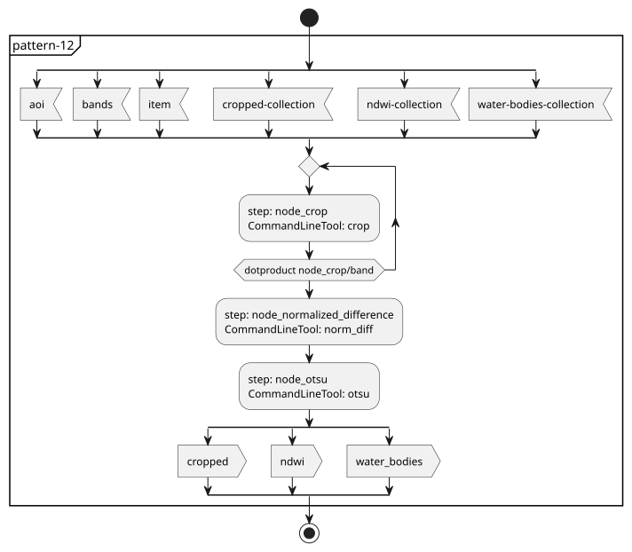
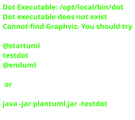
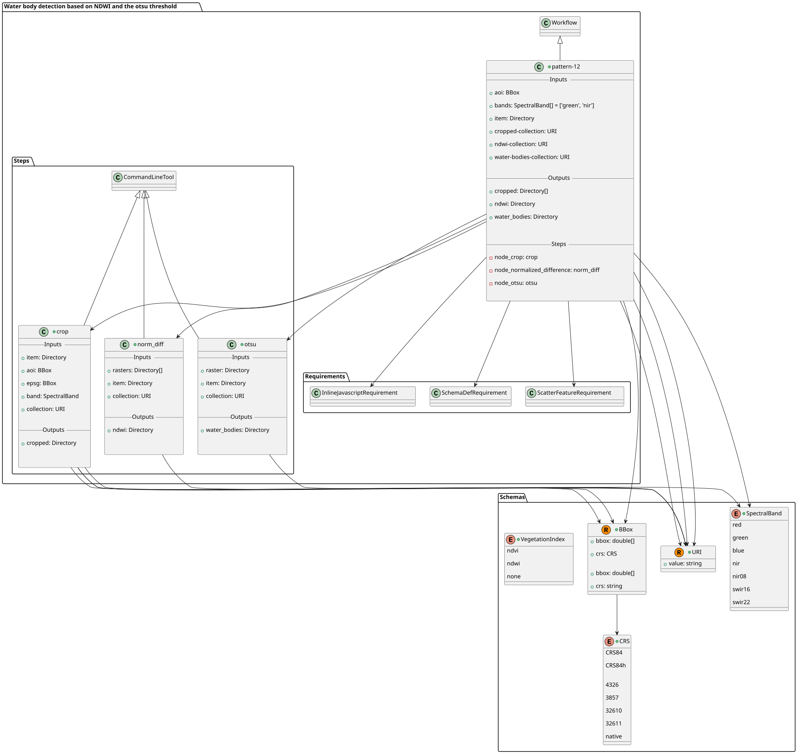
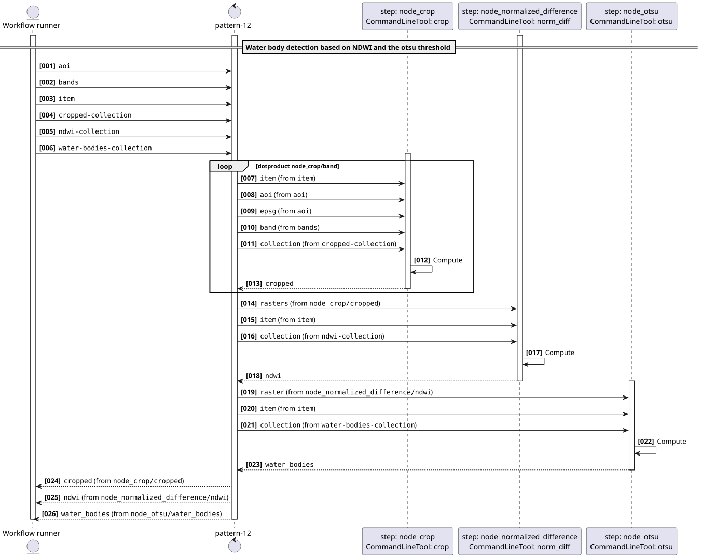
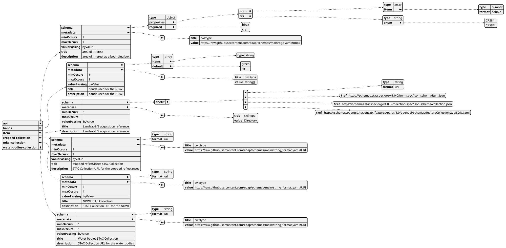
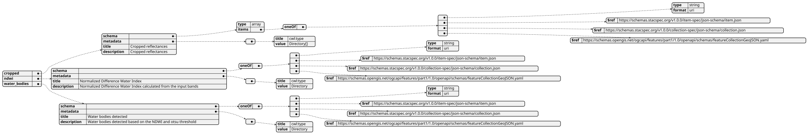

# pattern-12

Repository: https://github.com/eoap/application-package-patterns

Version: 2.0.0

License: {'@type': 's:CreativeWork', 's:identifier': 'Apache-2.0', 's:name': 'Apache License 2.0', 's:url': 'https://spdx.org/licenses/Apache-2.0.html'}

Author: Lois Lane (lois.lane@meoga.com)

Author: Clark Kent (clark.kent@meoga.com)

## Water body detection based on NDWI and the otsu threshold

Water bodies detection based on NDWI and otsu threshold applied to Sentinel-2 or Landsat-9 staged acquisitions

### Inputs

| Name | Type | Description |
| --- | --- | --- |
| aoi | `https://raw.githubusercontent.com/eoap/schemas/main/ogc.yaml#BBox` | area of interest as a bounding box |
| bands | `#SpectralBand[]` | bands used for the NDWI |
| item | `Directory` | Landsat-8/9 acquisition reference |
| cropped-collection | `https://raw.githubusercontent.com/eoap/schemas/main/string_format.yaml#URI` | STAC Collection URL for the cropped reflectances |
| ndwi-collection | `https://raw.githubusercontent.com/eoap/schemas/main/string_format.yaml#URI` | STAC Collection URL for the NDWI |
| water-bodies-collection | `https://raw.githubusercontent.com/eoap/schemas/main/string_format.yaml#URI` | STAC Collection URL for the water bodies |

### Outputs

| Name | Type | Description |
| --- | --- | --- |
| cropped | `Directory[]` | Cropped reflectances |
| ndwi | `Directory` | Normalized Difference Water Index calculated from the input bands |
| water_bodies | `Directory` | Water bodies detected based on the NDWI and otsu threshold |

Shared schema: https://raw.githubusercontent.com/eoap/schemas/main/ogc.yaml

### Type `https://raw.githubusercontent.com/eoap/schemas/main/string_format.yaml#URI`

```yaml
name: https://raw.githubusercontent.com/eoap/schemas/main/string_format.yaml#URI
type: record
fields:
- name: value
  type: string
```

### Type `#BBox`

```yaml
name: '#BBox'
type: record
fields:
- name: bbox
  type:
    type: array
    items: double
- name: crs
  type: string
```

### Type `#SpectralBand`

```yaml
name: '#SpectralBand'
type: enum
symbols:
- red
- green
- blue
- nir
- nir08
- swir16
- swir22
```

### Type `#CRS`

```yaml
name: '#CRS'
type: enum
symbols:
- '4326'
- '3857'
- '32610'
- '32611'
- native
```

### Type `#VegetationIndex`

```yaml
name: '#VegetationIndex'
type: enum
symbols:
- ndvi
- ndwi
- none
```

## crop

application-package-patterns: crop.

### Inputs

| Name | Type | Description |
| --- | --- | --- |
| item | `Directory` | item. |
| aoi | `https://raw.githubusercontent.com/eoap/schemas/main/ogc.yaml#BBox` | Area of interest defined as a bounding box |
| epsg | `https://raw.githubusercontent.com/eoap/schemas/main/ogc.yaml#BBox` | epsg. |
| band | `#SpectralBand` | band. |
| collection | `https://raw.githubusercontent.com/eoap/schemas/main/string_format.yaml#URI` | collection. |

### Outputs

| Name | Type | Description |
| --- | --- | --- |
| cropped | `Directory` | cropped. |

Shared schema: https://raw.githubusercontent.com/eoap/schemas/main/ogc.yaml

### Type `https://raw.githubusercontent.com/eoap/schemas/main/string_format.yaml#URI`

```yaml
name: https://raw.githubusercontent.com/eoap/schemas/main/string_format.yaml#URI
type: record
fields:
- name: value
  type: string
```

### Type `#BBox`

```yaml
name: '#BBox'
type: record
fields:
- name: bbox
  type:
    type: array
    items: double
- name: crs
  type: string
```

### Type `#SpectralBand`

```yaml
name: '#SpectralBand'
type: enum
symbols:
- red
- green
- blue
- nir
- nir08
- swir16
- swir22
```

### Type `#CRS`

```yaml
name: '#CRS'
type: enum
symbols:
- '4326'
- '3857'
- '32610'
- '32611'
- native
```

### Type `#VegetationIndex`

```yaml
name: '#VegetationIndex'
type: enum
symbols:
- ndvi
- ndwi
- none
```

## norm_diff

application-package-patterns: norm_diff.

### Inputs

| Name | Type | Description |
| --- | --- | --- |
| rasters | `Directory[]` | rasters. |
| item | `Directory` | item. |
| collection | `https://raw.githubusercontent.com/eoap/schemas/main/string_format.yaml#URI` | collection. |

### Outputs

| Name | Type | Description |
| --- | --- | --- |
| ndwi | `Directory` | ndwi. |

### Type `https://raw.githubusercontent.com/eoap/schemas/main/string_format.yaml#URI`

```yaml
name: https://raw.githubusercontent.com/eoap/schemas/main/string_format.yaml#URI
type: record
fields:
- name: value
  type: string
```

### Type `#BBox`

```yaml
name: '#BBox'
type: record
fields:
- name: bbox
  type:
    type: array
    items: double
- name: crs
  type: string
```

### Type `#SpectralBand`

```yaml
name: '#SpectralBand'
type: enum
symbols:
- red
- green
- blue
- nir
- nir08
- swir16
- swir22
```

### Type `#CRS`

```yaml
name: '#CRS'
type: enum
symbols:
- '4326'
- '3857'
- '32610'
- '32611'
- native
```

### Type `#VegetationIndex`

```yaml
name: '#VegetationIndex'
type: enum
symbols:
- ndvi
- ndwi
- none
```

## otsu

application-package-patterns: otsu.

### Inputs

| Name | Type | Description |
| --- | --- | --- |
| raster | `Directory` | raster. |
| item | `Directory` | item. |
| collection | `https://raw.githubusercontent.com/eoap/schemas/main/string_format.yaml#URI` | collection. |

### Outputs

| Name | Type | Description |
| --- | --- | --- |
| water_bodies | `Directory` | water bodies. |

### Type `https://raw.githubusercontent.com/eoap/schemas/main/string_format.yaml#URI`

```yaml
name: https://raw.githubusercontent.com/eoap/schemas/main/string_format.yaml#URI
type: record
fields:
- name: value
  type: string
```

### Type `#BBox`

```yaml
name: '#BBox'
type: record
fields:
- name: bbox
  type:
    type: array
    items: double
- name: crs
  type: string
```

### Type `#SpectralBand`

```yaml
name: '#SpectralBand'
type: enum
symbols:
- red
- green
- blue
- nir
- nir08
- swir16
- swir22
```

### Type `#CRS`

```yaml
name: '#CRS'
type: enum
symbols:
- '4326'
- '3857'
- '32610'
- '32611'
- native
```

### Type `#VegetationIndex`

```yaml
name: '#VegetationIndex'
type: enum
symbols:
- ndvi
- ndwi
- none
```

## Run the wrapped pattern

The application uses local File/Directory ports. `eoap-cwlwrap` converts these to typed URI references and composes mastering 2.0.0 staging, using immutable GHCR container digests. Configure `PATTERNS_S3_ENDPOINT` for your S3 service.

```bash
python scripts/run-acceptance.py --case pattern-12
```

The typed application inputs are:

```json
{
  "aoi": {
    "bbox": [
      -118.985,
      38.432,
      -118.183,
      38.938
    ],
    "crs": "CRS84"
  },
  "item": {
    "value": "https://planetarycomputer.microsoft.com/api/stac/v1/collections/landsat-c2-l2/items/LC08_L2SP_042033_20231007_02_T1"
  },
  "bands": [
    "green",
    "nir08"
  ],
  "cropped-collection": {
    "value": "https://github.com/eoap/application-package-patterns/raw/7af45d5/collections/cropped_collection.json"
  },
  "ndwi-collection": {
    "value": "https://github.com/eoap/application-package-patterns/raw/7af45d5/collections/ndi_collection.json"
  },
  "water-bodies-collection": {
    "value": "https://github.com/eoap/application-package-patterns/raw/7af45d5/collections/water_bodies_collection.json"
  }
}
```

The acceptance runner adds S3 credentials, bucket and a unique publication prefix. It verifies returned STAC links and georeferenced raster assets against the actual area of interest.

## Diagrams

### Activity



[PlantUML source](pattern-12/activity.puml)

### Component



[PlantUML source](pattern-12/component.puml)

### Class



[PlantUML source](pattern-12/class.puml)

### Sequence



[PlantUML source](pattern-12/sequence.puml)

### State


[PlantUML source](pattern-12/state.puml)

### Ogc Processes Inputs



[PlantUML source](pattern-12/ogc_processes_inputs.puml)

### Ogc Processes Outputs



[PlantUML source](pattern-12/ogc_processes_outputs.puml)
